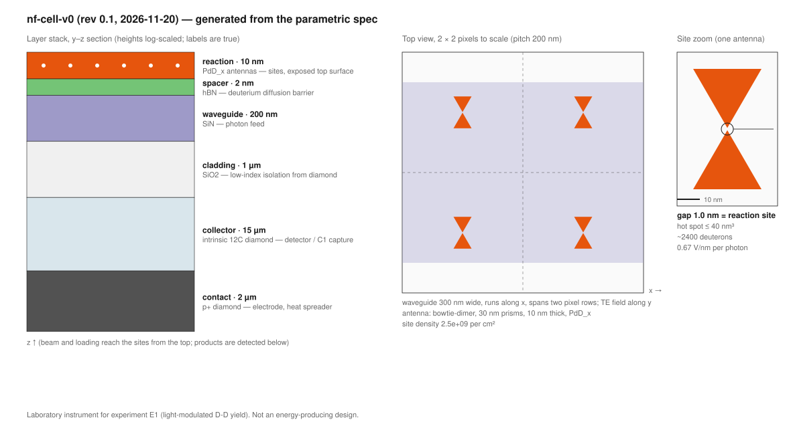

# NanoFusion

Working repository for the NanoFusion concept: many small, high-efficiency fusion reaction sites built
to atomic specification and run in parallel, aimed at a fusion battery. It continues the two Google
Docs ("NanoFusion", 2014–2023, and "NanoFusion Notes").

Current direction (Nov 2026): synthetic crystals in the low-energy nuclear reaction regime, with
reaction sites driven by on-board photon sources, assuming near-future atomic-level synthesis.

## Where things are

| File | What it is |
|---|---|
| [`docs/roadmap-10yr.md`](docs/roadmap-10yr.md) | The 10-year plan, 2027–2036: phases, experiments, gates, off-ramps |
| [`docs/literature-review.md`](docs/literature-review.md) | What the literature supports and does not, in three evidence tiers |
| [`docs/physics-baseline.md`](docs/physics-baseline.md) | The four walls and the numbers a design must beat |
| [`docs/design-notes.md`](docs/design-notes.md) | Running design log toward the CAD model and simulator |
| [`design/nf-cell-v0.yaml`](design/nf-cell-v0.yaml) | Parametric spec of the first cell (source of truth for CAD) |
| [`design/nf-cell-v0.svg`](design/nf-cell-v0.svg) | Drawing generated from the spec by [`cad/render_cell.py`](cad/render_cell.py) |
| [`design/sites/S1-PdD-vacancy.xyz`](design/sites/S1-PdD-vacancy.xyz) | Atom-exact model of site S1 (Pd vacancy in PdD), from [`cad/gen_site.py`](cad/gen_site.py) |
| [`sim/baseline.py`](sim/baseline.py) | Baseline physics calculator; seed of the simulator |
| [`sim/test_baseline.py`](sim/test_baseline.py) | Regression tests pinned to published cross-section and stopping values |

## The short version

1. Lattices really do change low-energy fusion rates, by more than theory explains, and the evidence
   strengthened in 2025–2026 (15 % from electrochemical loading in *Nature*; a sub-keV plateau > 10¹⁸
   above bare-nucleus rates in *Nature Communications*). None of it is near useful power.
2. No experiment has confirmed that low-intensity light changes a nuclear rate. The idea has a
   peer-reviewed theoretical motivation, a Google/Maryland patent family, a 2025 plasmonic-nanoshell
   proposal, and one unreplicated two-laser claim. It can be tested cheaply.
3. Firing ions into cold matter is capped at a gain of 0.1–1 % by electronic stopping, whatever the
   recirculation scheme. Removing the electrons from the reaction zone lifts that ceiling about a
   thousandfold on paper.
4. So the plan is gate-driven: three years to find out whether structure or light controls a nuclear
   rate, with products and publishable nulls at each step, before any atomically precise reactor is
   built.

## Run the baseline

```bash
python3 sim/baseline.py
```

Standard library only. Output is saved in `sim/baseline-output.txt`.

```bash
python3 sim/test_baseline.py
```

```bash
python3 cad/render_cell.py
```

```bash
python3 cad/gen_site.py
```

The two `cad/` scripts need PyYAML.

## First cell



## Status

Planning and modelling only. No hardware, no experimental results of our own.
