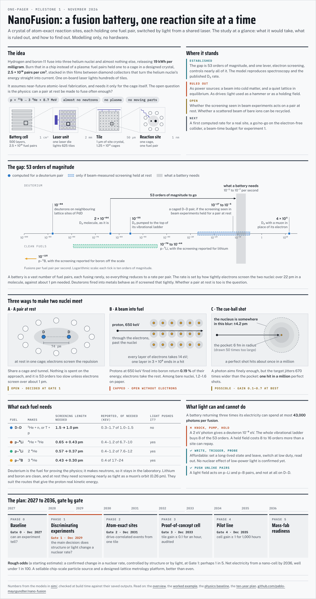

# NanoFusion

Working repository for the NanoFusion concept: many small fusion reaction sites built to atomic
specification and run in parallel, aimed at a fusion battery. It continues the two Google Docs
("NanoFusion", 2014–2023, and "NanoFusion Notes").

Current direction: synthetic crystals in the low-energy nuclear reaction regime, with reaction sites
switched or driven by shared on-board light sources, assuming near-future atomic-level synthesis.
Product fuels are p-¹¹B or p-⁷Li; deuterium is the laboratory fuel.

**Site: <https://pablo-mayrgundter.github.io/nano-fusion/>**, with the study on one page at
[onepager.html](https://pablo-mayrgundter.github.io/nano-fusion/onepager.html).
Milestone 1 was marked on 2026-11-20 (tag `m1`, [`MILESTONES.md`](MILESTONES.md)).

**Start with [`docs/worked-example.md`](docs/worked-example.md)**: the whole argument in nine steps,
each a number you can reproduce.

[](https://pablo-mayrgundter.github.io/nano-fusion/onepager.html)

## Where things are

| File | What it is |
|---|---|
| [`docs/worked-example.md`](docs/worked-example.md) | From one D₂ molecule to a battery tile, step by step |
| [`docs/roadmap-10yr.md`](docs/roadmap-10yr.md) | The 10-year plan, 2027–2036: phases, experiments, gates, off-ramps |
| [`docs/literature-review.md`](docs/literature-review.md) | What the literature supports and does not; fifteen papers read in full |
| [`docs/physics-baseline.md`](docs/physics-baseline.md) | The four walls and the numbers a design must beat |
| [`docs/design-notes.md`](docs/design-notes.md) | Running design log, decisions, site and drive catalogues |
| [`design/nf-cell-v0.yaml`](design/nf-cell-v0.yaml) | Laboratory cell v0 (deuterium, experiment E1) |
| [`design/nf-cell-v1.yaml`](design/nf-cell-v1.yaml) | Product-architecture concept v1 (aneutronic, shared laser units) |
| [`design/step/`](design/step/README.md) | STEP models for Bldrs: v0 pixel block, v1 laser unit, with a viewer checklist |
| [`design/sites/S1-PdD-vacancy.xyz`](design/sites/S1-PdD-vacancy.xyz) | Atom-exact model of site S1 (Pd vacancy in PdD) |
| [`sim/pair_fusion.py`](sim/pair_fusion.py) | Site physics: fusion rate of a resting fuel pair |
| [`sim/cell_model.py`](sim/cell_model.py) | Device level: what a site must do for a given battery |
| [`sim/baseline.py`](sim/baseline.py) | Beam physics: cross sections, stopping, gain ceilings |
| [`sim/beam_route.py`](sim/beam_route.py) | Lattice route versus beam route for the product fuels |
| [`sim/cue_ball.py`](sim/cue_ball.py) | The aimed single shot: pocket, jitter, and what perfect aiming buys |
| [`sim/e1_budget.py`](sim/e1_budget.py) | Count-rate and sensitivity budget for the first experiment |
| [`cad/build_step.py`](cad/build_step.py), [`cad/render_cell.py`](cad/render_cell.py), [`cad/gen_site.py`](cad/gen_site.py) | Code-CAD: STEP export, 2D drawing, atomistic site generator |
| [`index.html`](index.html), [`onepager.html`](onepager.html), [`site/`](site/build.py) | The published site: overview and one-pager, generated by `site/build.py` |
| [`MILESTONES.md`](MILESTONES.md) | What each milestone delivered, found and left undone |

## The short version

1. A resting D₂ pair fuses at 2 × 10⁻⁶⁴ per second (reproduced here; published value 3 × 10⁻⁶⁴). A
   battery needs 10⁻¹¹ to 10⁻⁷. The rate is set almost entirely by how tightly electrons screen the
   pair: about 22 pm in a molecule, about 1–1.5 pm needed.
2. Deuterons fired into metals behave as if screened by 0.3–1.7 keV, which is the size a resting pair
   would need. Whether that applies to a pair at rest is the open question, and the data have known
   artifacts. None of it is near useful power.
3. The product fuels need 0.3–0.6 pm, close to a muon's orbit and about ten times beyond anything
   reported for lithium or boron. Deuterium is the fuel for proving the physics; p-¹¹B fits the
   schemes that give the proton real kinetic energy.
4. Light cannot sustain a site: a held optical field costs 8–16 orders of magnitude more than a site
   can repay. It can write long-lived states, trigger, and probe. It couples directly to p–Li and
   p–B pairs and not at all to D–D.
5. Firing ions into cold matter is capped at a gain of 0.1–1 % by electronic stopping. Removing the
   electrons from the reaction zone lifts that ceiling about a thousandfold on paper.
6. So the plan is gate-driven: three years to find out whether structure or light controls a nuclear
   rate, with products and publishable nulls at each step.


## Run

Standard library only:

```bash
python3 sim/pair_fusion.py
```

```bash
python3 sim/baseline.py
```

```bash
python3 sim/e1_budget.py
```

```bash
python3 sim/test_baseline.py
```

```bash
python3 sim/test_pair_fusion.py
```

With `pip install -r requirements.txt` (PyYAML, CadQuery):

```bash
python3 sim/cell_model.py
```

```bash
python3 cad/build_step.py --svg
```

Saved outputs of each script are in `sim/*-output.txt`.

## The site

Two static pages with inline SVG, served by GitHub Pages from the repository root:

```bash
python3 site/build.py
```

The build refuses to run if a number the pages rely on is no longer in the saved simulator outputs.
`python3 sim/plot_pair_fusion.py` redraws the screening chart (for the docs and for the site), and
`node site/snap.js` re-renders the one-pager image and the link-preview card (needs Playwright).

## Status

Planning and modelling only. No hardware, no experimental results of our own.
